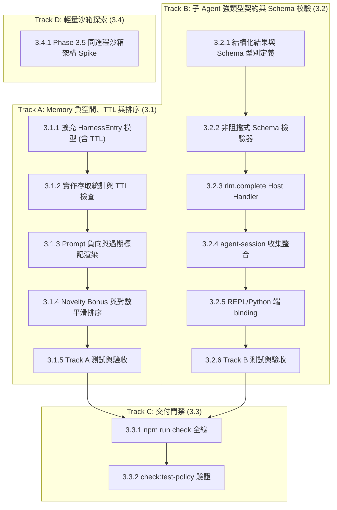

# HarnessState 與 RLM 機制改善 — Phase 3 架構實施計劃（增強版）

- 依據文件：[`docs/harness-rlm-tune-suggest.md`](file:///home/ck/apollo-cli/docs/harness-rlm-tune-suggest.md)（Phase 3: P2 認知架構優化與多 Agent 契約）
- 產出日期：2026-10-24
- 涵蓋範圍：
  1. **Memory 負向約束、TTL 與動態淘汰機制**（Negative Space、Negative TTL、Novelty Bonus、Access Tracking 與動態 Digest 淘汰）
  2. **子 Agent 強類型契約與 Schema 校驗**（Typed Subagent Result Contract、JSON Schema Validation、`rlm.collect()` 強化）
  3. **輕量同進程沙箱探索（Phase 3.5 Spike / Track D）**（In-process Sandbox 隔離與效能評估）

---

## 一、 事實評估與現況核實（Fact & Gap Analysis）

依據目前 codebase 最新狀態（`HEAD 7453e9f` 及 Phase 2 成果）核實 Phase 3 涉及之模組與邏輯：

### 1. HarnessState Memory 無負空間、無存取統計與淘汰機制（P2 - 5）
- **核實位置**：
  - `apollo-cli-runtime/src/rlm/harness.ts` (`HarnessEntry`, `HarnessEntryInit`, `HarnessState`)
  - `packages/coding-agent/src/core/refinement/refinement.ts` (`formatHarnessStateForPrompt`, `compareRankedHarnessEntries`, `scoreHarnessEntryForQuery`)
- **現狀問題與深入技術風險**：
  - **缺乏顯式負向空間（Negative Space）**：模型在探索大型專案時，常重複試探已證實無效的路徑（例如死備份目錄、失效的 API endpoint 或不支援的 flag）。目前 `HarnessEntry` 缺乏一等公民的負向標記，模型只能寫在文本中，容易被 prompt digest 當成正常正向記憶匹配。
  - **「毒性蔓延」與「負向誤殺」風險**：若模型因偶發網路抖動或環境變數暫時缺失，錯誤地將一條路徑標記為負向，若無過期機制（TTL）將導致該路徑永久不可用。
  - **新記憶的冷啟動陷阱**：依賴 `hit_count` 排序時，剛產生、尚未累積點擊但極具價值的即時記憶（`hit_count = 0`），可能被老舊高頻記憶壓制而無法出現在 prompt digest 中。
  - **缺少存取/命中統計**：`HarnessEntry` 缺乏 `hit_count` 與 `last_accessed_at`，無法區分高頻核心知識與過期冷門記憶。

### 2. 子 Agent 結果契約是軟性的，缺乏 Schema 校驗與結構化回報（P2 - 6）
- **核實位置**：
  - `packages/coding-agent/src/core/rlm-runtime.ts` (`createRlmCollectHostHandler`, `RlmCollectResultEntry`)
  - `packages/coding-agent/src/core/agent-session.ts` (`collectRlmSubagents`)
  - `apollo-cli-runtime/src/rlm/harness.ts` / Python runtime RLM binding
- **現狀問題與深入技術風險**：
  - **軟性回報合約（Soft Contract）**：子 agent 是否回傳結果依賴主動發送文字訊息或寫檔。父 agent 在呼叫 `rlm.collect()` 時，僅能取得狀態字串與 answer preview，缺乏強型別與結構化輸出。
  - **Payload 結構漂移（Schema Drift）**：子 agent 雖然可能回傳 JSON，但欄位命名可能與父 agent 期望不符，缺乏非破壞性校驗機制，易導致父端解析拋錯或陷入二次幻覺。
  - **輕量探索任務的重型行程開銷**：對於單純計算或短期探索的 sub-task，每次均需 spawn 獨立 session 與進程，缺乏輕量同進程執行環境。

---

## 二、 架構實施目標與驗收標準（Goals & Acceptance Criteria）

### 1. 實施目標 (Objective)
1. **認知記憶負向空間、動態生命週期與雙向平衡**：
   - 在 `HarnessEntry` 原生支援負向標記（`negative: boolean`）與負向時效性（`negative_ttl_seconds` / `negative_expires_at`）。
   - 排序數學模型納入 **新穎度紅利 (Novelty Bonus)** 與 **存取頻率對數平滑 (Access Log-scale Smoothing)**，動態平衡新舊記憶。
   - 支援「打破禁忌 (Break Taboo)」提示機制：當常規搜索無果時，降級注入過期負向記憶供模型重新驗證。
2. **子 Agent 強類型契約與非阻擋式 Schema 校驗**：
   - 定義標準退出合約（包含 `exit_code`、`data: Record<string, unknown>`、`artifacts: string[]`、`schema_mismatch: boolean`）。
   - `rlm.spawn` 支援宣告 `expected_schema`；Host Collector 在子 agent `rlm.complete()` 時進行非破壞性 Schema 校驗。
   - 強化 `rlm.collect()`，具備結構化聚合、狀態辨識與雙向相容 fallback。
3. **輕量同進程隔離探索（Phase 3.5 Spike / Track D）**：
   - 設計基於 `node:vm` 或沙箱隔離的原型規格，評估同進程輕量執行的可行性與效能。

### 2. 驗收標準 (Acceptance Criteria)
1. **負向標記、TTL 與新穎度平衡**：
   - `HarnessEntry` 與 `HarnessEntryInit` 擴充 `negative?: boolean`、`negative_expires_at?: string`、`hit_count?: number`、`last_accessed_at?: string`。
   - Overview 渲染規範：
     - 若 `entry.negative === true` 且尚未過期，標註 `[NEGATIVE - AVOID]`。
     - 若負向記憶已逾期，自動降級或標註 `[NEGATIVE - EXPIRED]`。
   - 排序算法驗證：新建立條目（< 24 小時）獲得 Novelty Bonus（1.2x 權重加乘）；高頻條目依 `ln(1 + hit_count)` 增益；過期記憶依半衰期衰減。
2. **強類型契約與 Schema 校驗**：
   - 擴充 `RlmStructuredResult`：
     ```ts
     export interface RlmStructuredResult {
       exit_code: number;
       status: "succeeded" | "failed" | "timed_out" | "orphaned";
       summary?: string;
       data?: Record<string, unknown>;
       artifacts?: string[];
       schema_mismatch?: boolean;
       schema_validation_errors?: string[];
       error?: string;
     }
     ```
   - 父端 `rlm.collect()` 回傳包含結構化 `result: RlmStructuredResult`。
   - 子端透過 `rlm.complete(data, ...)` 提報；若結構與父端預期的 `expected_schema` 不符，設置 `schema_mismatch: true`，但保留原始 `data`，絕不中斷父 session。
3. **品質與測試門禁**：
   - 測試覆蓋負向標記、TTL 到期降級、Novelty Bonus 排序加權。
   - 測試 Schema 校驗與 mismatch 容錯 fallback。
   - 通過 `npm run check` 與專案測試政策驗證。

---

## 三、 詳細架構設計（Architecture Design）

### 3.1 記憶負向空間、TTL 與科學排序數學模型

```
+----------------------------------------------------------------------------+
|                                HarnessEntry                                |
|  - id, kind, title, content, path, scope, version                         |
|  - source_type: "observed" | "inferred"                                    |
|  - negative: boolean                                                       |
|  - negative_expires_at: string (ISO-8601，防止負向空間毒性蔓延)              |
|  - hit_count: number (存取/命中計數)                                        |
|  - last_accessed_at: string                                                |
|  - created_at: string, updated_at: string                                  |
+----------------------------------------------------------------------------+
                                      │
              ┌───────────────────────┴───────────────────────┐
              ▼                                               ▼
   [formatHarnessStateForPrompt]                     [harness.search / query]
   - negative 狀態判定：                              - 更新 hit_count += 1
     未過期 -> `[NEGATIVE - AVOID]`                   - 更新 last_accessed_at
     已過期 -> 降級或標註 `[NEGATIVE - EXPIRED]`       - 支援 include_negative 過濾
```

#### 排序數學模型（Scoring Formula）
```
FinalScore = RelevanceScore * TypeMultiplier * NoveltyBonus * RecencyDecay * FrequencyBoost
```
- **RelevanceScore**：基於 BM25 / TF-IDF 與多欄位匹配計算之相關度分數。
- **TypeMultiplier**：
  - `observed` = 1.0
  - `inferred` = 0.5（假說衰減）
- **NoveltyBonus**：
  - 若 `now - created_at < 24 小時`，給予 `1.2` 倍新穎度紅利，確保剛產生之重要線索具備冷啟動競爭力；超過 24 小時則為 `1.0`。
- **RecencyDecay**：
  - 基於 `last_accessed_at`（或 `updated_at`）計算半衰期衰減：
    `RecencyDecay = 0.5 ^ (age_days / half_life_days)`（建議 `half_life_days = 7`）。
  - 對於負向記憶，若未指定 `negative_expires_at`，預設給予更快的半衰期（如 3 天）此項與 Taboo Break、`include_negative` 過濾機制規劃於 Phase 3.5+ 實施。
- **FrequencyBoost**：
  - `FrequencyBoost = 1 + ln(1 + hit_count)`，使用自然對數進行平滑增益，避免馬太效應無限膨脹。

---

### 3.2 子 Agent 強類型契約與非破壞性 Schema 校驗

```
+-------------------+           rlm.spawn(..., { expected_schema })      +-------------------+
|                   | ─────────────────────────────────────────────────> |                   |
|   Parent Agent    |                                                    |    Child Agent    |
|   (IPython REPL)  |                                                    |   (Task Worker)   |
|                   | <───────────────────────────────────────────────── |                   |
+-------------------+             rlm.progress.note(msg)                 +-------------------+
          │                                                                        │
          │ rlm.collect(targets, timeout_ms)                                       │ rlm.complete({
          │                                                                        │   exit_code: 0,
          ▼                                                                        │   data: {...},
   [Host Collector] <──────────────────────────────────────────────────────────────┘   artifacts: [...]
          │                                                                        })
          │ (執行非阻擋式 Schema 檢驗)
          ├─ Match -> schema_mismatch: false
          └─ Mismatch -> schema_mismatch: true, 保留 raw data 並記錄錯誤
          ▼
   RlmCollectResultEntry:
   - rlm_child_id
   - status: "succeeded" | "failed" | ...
   - result: {
       exit_code: 0,
       data: Record<string, unknown>,
       artifacts: string[],
       schema_mismatch: boolean,
       schema_validation_errors: [...]
     }
```

- **非破壞性校驗原則**：即使子 Agent 產出的資料結構與 `expected_schema` 不符，Host 絕不中斷父 session 或丟棄資料，而是將 `schema_mismatch` 標記為 `true`，並提供錯誤清單，交由父端 LLM 進行自我修復或降級處理。
- **雙向相容 Fallback**：若子 Agent 正常結束但未顯式呼叫 `rlm.complete()`，系統自動自最後對話輸出或 answer preview 封裝為標準結構。

---

## 四、 詳細實作工作項目（Work Breakdown Structure）

### 工作項 3.1：Harness 資料模型擴充、負向 TTL 與排序優化（apollo-cli-runtime 與 packages/coding-agent）
- [x] **3.1.1 擴充 `HarnessEntry` 支援負向標記與 TTL (`harness.ts`)**
  - 新增欄位：`negative?: boolean`、`negative_expires_at?: string`、`hit_count?: number`、`last_accessed_at?: string`。
  - 更新 `__dataclass_fields__` 與反序列化相容邏輯（預設 `negative: false`, `hit_count: 0`）。
- [x] **3.1.2 實作存取統計與 TTL 檢查機制 (`harness.ts`)**
  - 在 `get_entry()`、`search()`、`update_entry()` 中更新 `hit_count` 與 `last_accessed_at`。
  - 新增輔助方法 `isNegativeActive(entry)` 判斷負向記憶是否仍在有效期內。
- [x] **3.1.3 Prompt 格式化支援負向狀態與過期標記 (`refinement.ts`)**
  - 對有效負向記憶渲染 `[NEGATIVE - AVOID]`；對過期負向記憶渲染 `[NEGATIVE - EXPIRED]`。
- [x] **3.1.4 實作 Novelty Bonus 與 Frequency 平滑排序公式 (`refinement.ts`)**
  - 於 `compareRankedHarnessEntries` 整合新穎度紅利（24 小時內 1.2x）、對數命中增益 `1 + ln(1 + hit_count)` 與半衰期時間衰減。
- [x] **3.1.5 單元測試補強 (`harness.test.ts` & `refinement.test.ts`)**
  - 驗證負向空間持久化、TTL 過期判定、Novelty Bonus 排序加權與時間衰減。

### 工作項 3.2：子 Agent 強類型契約與非阻擋式 Schema 校驗（packages/coding-agent 與 apollo-cli-runtime）
- [x] **3.2.1 定義強類型合約與 Schema 驗證型別 (`rlm-runtime.ts`)**
  - 定義 `RlmStructuredResult`（包含 `exit_code`, `data`, `artifacts`, `schema_mismatch`, `schema_validation_errors`）。
  - 在 `RlmRunRequest` 與 `RlmSpawnHandle` 支援 `expected_schema?: Record<string, unknown>`。
- [x] **3.2.2 實作輕量非阻擋式 Schema 校驗工具 (`rlm-runtime.ts`)**
  - 實作型別與必要欄位校驗函式，檢核子端提報之 `data`，回傳校驗結果而不安裝額外龐大依賴。
- [x] **3.2.3 子 Agent 提報協議之 Host Request Handler (`rlm.complete`)**
  - 接收子端提報之 `exit_code`、`data`、`artifacts`，結合 `expected_schema` 完成校驗並儲存至 session metadata。
- [x] **3.2.4 核心收集邏輯與回退推論 (`agent-session.ts`)**
  - `collectRlmSubagents` 提取子 session 結構化提報；若未顯式提報則依據 `status` 與 `answer_preview` 封裝相容結構。
- [x] **3.2.5 REPL / Python 端 RLM binding 支援 (`apollo-cli-runtime`)**
  - 在 REPL / Python 端提供 `rlm.complete(exit_code=0, data=None, artifacts=None)` 封裝。
- [x] **3.2.6 單元測試補強 (`rlm-collect.test.ts`)**
  - 測試正常結構化提報、Schema Mismatch 容錯與未顯式提報之 Fallback 機制。

### 工作項 3.3：交付門禁與品質驗證
- [x] **3.3.1 靜態型別與語意檢查 (`npm run check`)**
  - 確保無任何 TypeScript 型別報錯、無 `any`、無 inline import。
- [x] **3.3.2 測試策略合約檢查 (`npm run check:test-policy`)**
  - 確保測試檔案符合行數預算，無未授權的 sleep 或 mock。

### 工作項 3.4（Track D / Phase 3.5 Spike）：同進程輕量沙箱架構探索
- [x] **3.4.1 輕量同進程執行規格設計與評估報告**
  - 評估 `node:vm` 沙箱於單任務探索場景之記憶體與啟動延遲優勢，產出架構 Spike 評估說明。

---

## 五、 執行進度追蹤表（Checklist）

| 階段 | 編號 | 項目說明 | 負責模組 | 預期產物 | 狀態 |
|---|---|---|---|---|---|
| **3.1** | 3.1.1 | 擴充 `HarnessEntry` 支援 negative / negative_expires_at / hit_count / last_accessed_at | `apollo-cli-runtime` | `src/rlm/harness.ts` | ☑ 完成 |
| **3.1** | 3.1.2 | 實作 Harness 存取統計更新與負向有效性 (isNegativeActive) 檢查 | `apollo-cli-runtime` | `src/rlm/harness.ts` | ☑ 完成 |
| **3.1** | 3.1.3 | Prompt Digest 渲染支援 `[NEGATIVE - AVOID]` 與過期標籤 | `packages/coding-agent` | `src/core/refinement/refinement.ts` | ☑ 完成 |
| **3.1** | 3.1.4 | 實作 Novelty Bonus (1.2x) 與對數平滑頻率衰減排序算法 | `packages/coding-agent` | `src/core/refinement/refinement.ts` | ☑ 完成 |
| **3.1** | 3.1.5 | 負向空間、TTL 過期與 Novelty 排序單元測試補強 | runtime & coding-agent | `harness.test.ts`, `refinement.test.ts` | ☑ 完成 |
| **3.2** | 3.2.1 | 定義 `RlmStructuredResult` 結構化合約型別 (含 schema_mismatch) | `packages/coding-agent` | `src/core/rlm-runtime.ts` | ☑ 完成 |
| **3.2** | 3.2.2 | 實作非阻擋式 Schema 校驗邏輯 | `packages/coding-agent` | `src/core/rlm-runtime.ts` | ☑ 完成 |
| **3.2** | 3.2.3 | 實作子 Agent 提報協議之 Host Request Handler (`rlm.complete`) | `packages/coding-agent` | `src/core/rlm-runtime.ts` | ☑ 完成 |
| **3.2** | 3.2.4 | `agent-session` 整合結構化收集與未提報 fallback 推論 | `packages/coding-agent` | `src/core/agent-session.ts` | ☑ 完成 |
| **3.2** | 3.2.5 | REPL / Python 端 RLM binding 支援 `rlm.complete()` 提報封裝 | runtime / kernel | `apollo-cli-runtime/src/rlm/` | ☑ 完成 |
| **3.2** | 3.2.6 | 子 Agent 結構化契約、Schema Mismatch 與邊界單元測試 | `packages/coding-agent` | `test/rlm-collect.test.ts` | ☑ 完成 |
| **3.3** | 3.3.1 | 靜態型別與代碼風格檢查 (`npm run check`) | 全域 | CI 門禁通過 | ☑ 完成 |
| **3.3** | 3.3.2 | 測試策略與預算檢查 (`npm run check:test-policy`) | 全域 | 測試政策符合 | ☑ 完成 |
| **3.4** | 3.4.1 | 輕量同進程沙箱探索規格與 Spike 評估 (Phase 3.5) | 架構研究 | `docs/` | ☑ 完成 |

---

## 六、 實施排程與相依性（Roadmap & Milestones）



---

## 七、 效益評估與風險控制（Benefits & Risk Management）

| 項目 | 預期效益 | 潛在風險 | 防範措施 |
|---|---|---|---|
| **負向空間與 TTL** | 收斂模型無效探索路徑，節省 Token 並降低幻覺。 | 偶發錯誤導致誤殺正常路徑（毒性蔓延）。 | 引入 `negative_expires_at` 與負向快速衰減；提供常規無解時的打破禁忌機制。 |
| **新穎度紅利 (Novelty Bonus)** | 讓最新發現的重要線索（hit_count = 0）順利獲得曝光與實證。 | 粗製濫造的推論記憶干擾正常排序。 | 僅針對 24 小時內新記憶給予適度加權（1.2x），並配合 `inferred` 50% 衰減折扣。 |
| **強類型契約與 Schema 校驗** | 將跨 Agent 協同提升至函數調用等級的可靠度。 | 子端格式微幅漂移導致父端 Crash。 | 採取非阻擋式校驗，記錄 `schema_mismatch: true` 並完整保留 raw data，由 LLM 彈性調適。 |
| **同進程沙箱探索 (Spike)** | 釐清低開銷 sub-task 的演進路線。 | 探索過度排擠主線交付。 | 列為 Track D / Phase 3.5 Spike，以文件與規格研究為主，不阻塞主線發布。 |
