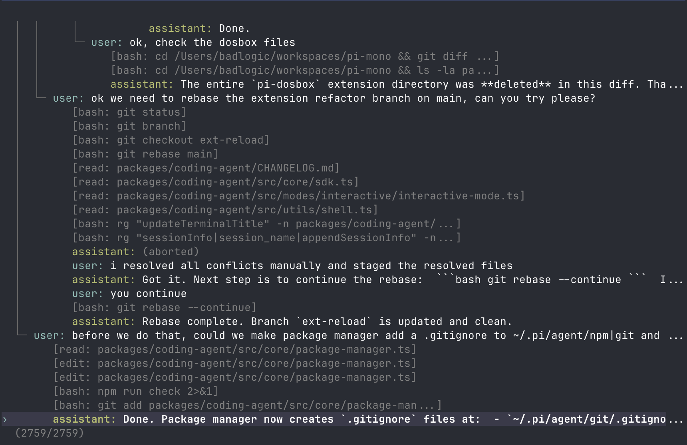

<p align="center">
  <a href="https://primeintellect.ai">
    <picture>
      <source media="(prefers-color-scheme: dark)" srcset="../../assets/brand/prime-butterfly.svg">
      
    </picture>
  </a>
</p>

<h1 align="center">Apollo CLI</h1>

<p align="center">
  RLM-native terminal coding and research harness.
</p>

Apollo CLI began as a hard fork of [pi-mono](https://github.com/badlogic/pi-mono), but it is now developed and distributed independently. This workspace retains inherited `@earendil-works/pi-*` source package identifiers, the `pi` package manifest key, and a source-package `pi` bin entry for internal compatibility. Public releases are currently versioned tarball artifacts; release packaging rewrites the application package and command to `apollo-cli`. Do not use the inherited npm package as the Apollo CLI install path.

## Table of Contents

- [Quick Start](#quick-start)
- [Providers & Models](#providers--models)
- [Interactive Mode](#interactive-mode)
  - [Editor](#editor)
  - [Commands](#commands)
  - [Keyboard Shortcuts](#keyboard-shortcuts)
  - [Message Queue](#message-queue)
- [Sessions](#sessions)
  - [Branching](#branching)
  - [Compaction](#compaction)
- [Settings](#settings)
- [Context Files](#context-files)
- [Customization](#customization)
  - [Prompt Templates](#prompt-templates)
  - [Skills](#skills)
  - [MCP Integrations](#mcp-integrations)
  - [Extensions](#extensions)
  - [Themes](#themes)
  - [Apollo CLI Packages](#apollo-cli-packages)
- [Programmatic Usage](#programmatic-usage)
- [Upstream](#upstream)
- [CLI Reference](#cli-reference)

## Quick Start

Run from source (Node.js 22.8.0 or newer):

```bash
git clone https://github.com/Jackhuang13/apollo-cli
cd apollo-cli
npm ci
./apollo-cli.sh
```

Authenticate with an API key:

```bash
export ANTHROPIC_API_KEY=sk-ant-...
apollo-cli
```

Or use your existing subscription:

```bash
apollo-cli
/login  # Then select provider
```

Then just talk to Apollo CLI. By default, Apollo CLI gives the model one tool: `iscript` (`ipython` remains an alias). The model uses the persistent IScript (TypeScript) REPL kernel to read files, run commands, edit code, and inspect data. Add capabilities via [skills](#skills), [prompt templates](#prompt-templates), [extensions](#extensions), or [Apollo CLI packages](#apollo-cli-packages).

The IScript kernel ships with the release and runs on the host Node.js runtime. Set `APOLLO_KERNEL_DENO` to run the kernel with a Deno binary instead.

**Platform notes:** [Windows](docs/windows.md) | [Termux (Android)](docs/termux.md) | [tmux](docs/tmux.md) | [Terminal setup](docs/terminal-setup.md) | [Shell aliases](docs/shell-aliases.md)

## Providers & Models

For each built-in provider, Apollo CLI maintains a list of tool-capable models, updated with every release. Authenticate via subscription (`/login`) or API key, then select any model from that provider via `/model` (or Ctrl+L).

Development checkouts do not commit the generated bundled catalog snapshots. Before running catalog-dependent tests in a fresh checkout, generate them once from the catalog repo:

```bash
npm run catalog:assets -- --catalog-dir /path/to/prime-agent-catalog
```

Or fetch the private catalog with `GITHUB_TOKEN` or `PRIME_CATALOG_REPO_TOKEN`:

```bash
PRIME_CATALOG_REPO_TOKEN=... npm run catalog:assets
```

For pack-smoke work without catalog access, use `npm run catalog:assets -- --fixture`. Fixture assets are not release assets.

**Subscriptions:**
- Anthropic Claude Pro/Max
- OpenAI ChatGPT Plus/Pro (Codex)
- GitHub Copilot
- xAI Grok (eligible subscriptions)

Select the xAI subscription entry in `/login` to sign in. Model access depends on your xAI account entitlement. See [xAI setup](docs/providers.md#xai-grok).

**API keys:**
- Anthropic
- OpenAI
- Prime Inference
- Azure OpenAI
- DeepSeek
- Google Gemini
- Google Vertex
- Amazon Bedrock
- Mistral
- Groq
- Cerebras
- Cloudflare AI Gateway
- Cloudflare Workers AI
- xAI
- OpenRouter
- Vercel AI Gateway
- ZAI
- OpenCode Zen
- OpenCode Go
- Hugging Face
- Fireworks
- Kimi For Coding
- MiniMax
- Xiaomi MiMo
- Xiaomi MiMo Token Plan (China)
- Xiaomi MiMo Token Plan (Amsterdam)
- Xiaomi MiMo Token Plan (Singapore)

Prime Inference credentials and teams belong to Apollo CLI's `~/.apollo/agent/auth.json`. Normal use ignores Prime CLI's `~/.prime/config.json`. If you previously relied on CLI credentials, run `/login` once: Agent can import a production-compatible CLI key after production validation, without changing CLI config. `PRIME_API_KEY` still overrides the saved Agent key.

See [docs/providers.md](docs/providers.md) for detailed setup instructions.

**Custom providers & models:** Add providers via `~/.apollo/agent/models.json` if they speak a supported API (OpenAI, Anthropic, Google). For custom APIs or OAuth, use extensions. See [docs/models.md](docs/models.md) and [docs/custom-provider.md](docs/custom-provider.md).

## Interactive Mode

<p align="center"></p>

The interface from top to bottom:

- **Startup header** - Shows a compact brand and runtime summary; use `--verbose` to list loaded AGENTS.md files, prompt templates, skills, and extensions
- **Messages** - Your messages, assistant responses, tool calls and results, notifications, errors, and extension UI
- **Editor** - Where you type
- **Footer** - Empty by default; use `/usage` for token, cost, and context details

The editor can be temporarily replaced by other UI, like built-in `/settings` or custom UI from extensions (e.g., a Q&A tool that lets the user answer model questions in a structured format). [Extensions](#extensions) can also replace the editor, add widgets above/below it, a status line, custom footer, or overlays.

### Editor

| Feature | How |
|---------|-----|
| File reference | Type `@` to fuzzy-search project files |
| Path completion | Tab to complete paths |
| Multi-line | Shift+Enter (or Ctrl+Enter on Windows Terminal) |
| Images | Ctrl+V to paste (Alt+V on Windows), or drag onto terminal |
| Bash commands | `!command` runs and sends output to LLM, `!!command` runs without sending |

Standard editing keybindings for delete word, undo, etc. See [docs/keybindings.md](docs/keybindings.md).

### Commands

Type `/` in the editor to trigger commands. [Extensions](#extensions) can register custom commands, [skills](#skills) are available as `/skill:name`, and [prompt templates](#prompt-templates) expand via `/templatename`.

| Command | Description |
|---------|-------------|
| `/login`, `/logout` | OAuth authentication |
| `/model` | Switch models |
| `/effort` | Set reasoning/thinking level |
| `/scoped-models` | Enable/disable models for Alt+M cycling |
| `/settings` | Thinking level, theme, message delivery, transport |
| `/resume [id\|path]` | Open the agents view, or resume a session directly |
| `/new`, `/clear` | Start a new session |
| `/name <name>` | Set session display name |
| `/session` | Show session info (file, ID, messages) |
| `/traces [status\|on\|off\|preview\|upload-current\|upload-all\|login]` | Preview traces, run one-shot current/all uploads, and manage automatic sharing (`upload` aliases `upload-current`) |
| `/usage` | Show token, cost, and context usage |
| `/speed [on\|off]` | Toggle footer readout of model output tok/sec (latest response and session average) |
| `/tree` | Jump to any point in the session and continue from there |
| `/fork` | Create a new session from a previous user message |
| `/clone` | Duplicate the current active branch into a new session |
| `/compact [prompt]` | Manually compact context, optional custom instructions |
| `/copy` | Copy last assistant message to clipboard |
| `/btw <question>`, `/side <question>` | Ask an inline side question without adding it to the session; replies continue the side conversation, esc returns |
| `/export [file]` | Export session to HTML file |
| `/share` | Upload as private GitHub gist with shareable HTML link |
| `/reload` | Reload keybindings, extensions, skills, prompts, and context files (themes hot-reload automatically) |
| `/hotkeys` | Show all keyboard shortcuts |
| `/changelog` | Display version history |
| `/quit` | Quit Apollo CLI |

Trace uploads use environment or Agent-owned credentials, not live Prime CLI credentials. `/traces login` can reuse a CLI key only after production URL and scope validation. See [trace sharing credentials](docs/providers.md#trace-sharing-credentials).

### Keyboard Shortcuts

See `/hotkeys` for the full list. Customize via `~/.apollo/agent/keybindings.json`. See [docs/keybindings.md](docs/keybindings.md).

**Commonly used:**

| Key | Action |
|-----|--------|
| Ctrl+C | Interrupt active work, or show the exit hint when idle |
| Ctrl+C twice | Exit while the exit hint is visible |
| Escape | Clear the input without interrupting active work |
| Escape twice | Open `/tree` |
| Ctrl+L | Open model selector |
| Alt+M / Shift+Alt+M | Cycle scoped models forward/backward |
| Ctrl+O | Cycle overview → thinking and file diffs → all output |

### Message Queue

Submit messages while the agent is working:

- **Enter** queues a *steering* message, delivered after the current assistant turn finishes executing its tool calls
- **Alt+Enter** queues a *follow-up* message, delivered only after the agent finishes all work
- **Ctrl+C** interrupts active work; queued messages are kept and resume after your next submit or edit
- **Escape** clears the input without interrupting active work
- **Alt+Up / Alt+Down** browse queued messages individually and return to the editor draft
- While browsing, **Enter** applies the edit as steering input and **Alt+Enter** applies it as a follow-up; submitting an empty edit deletes the item
- **Ctrl+Alt+Up / Ctrl+Alt+Down** move the selected item earlier or later within its queue

On Windows Terminal, `Alt+Enter` is fullscreen by default. Remap it in [docs/terminal-setup.md](docs/terminal-setup.md) so Apollo CLI can receive the follow-up shortcut.

Configure delivery in [settings](docs/settings.md): `steeringMode` and `followUpMode` can be `"one-at-a-time"` (default, waits for response) or `"all"` (delivers all queued at once). `transport` selects provider transport preference (`"sse"`, `"websocket"`, or `"auto"`) for providers that support multiple transports.

## Sessions

Sessions are stored as JSONL files with a tree structure. Each entry has an `id` and `parentId`, enabling in-place branching without creating new files. See [docs/session-format.md](docs/session-format.md) for file format.

### Management

Sessions auto-save as flat JSONL files under `~/.apollo/agent/sessions/`. Each session header records its working directory, which the searchable session view uses to identify and open saved sessions.

```bash
apollo-cli -c                   # Continue most recent session
apollo-cli -r [path|id]         # Browse past sessions or resume one directly
apollo-cli --no-session         # Ephemeral mode (don't save)
apollo-cli --fork <path|id>     # Fork specific session file or ID into a new session
```

Use `/session` in interactive mode to see the current session ID before reusing it with `--resume <id>` or `--fork <id>`.

### Branching

**`/tree`** - Navigate the session tree in-place. Select any previous point, continue from there, and switch between branches. All history preserved in a single file.

<p align="center"></p>

- Search by typing, fold/unfold and jump between branches with Ctrl+←/Ctrl+→ or Alt+←/Alt+→, page with ←/→
- Filter modes (Ctrl+O): default → no-tools → user-only → labeled-only → all
- Press Shift+L to label entries as bookmarks and Shift+T to toggle label timestamps

**`/fork`** - Create a new session file from a previous user message on the active branch. Opens a selector, copies the active path up to that point, and places the selected prompt in the editor for modification.

**`/clone`** - Duplicate the current active branch into a new session file at the current position. The new session keeps the full active-path history and opens with an empty editor.

**`--fork <path|id>`** - Fork an existing session file or partial session UUID directly from the CLI. This copies the full source session into a new session file in the current project.

### Compaction

Long sessions can exhaust context windows. Compaction summarizes older messages while keeping recent ones.

**Manual:** `/compact` or `/compact <custom instructions>`

**Automatic:** Enabled by default. Triggers on context overflow (recovers and retries) or when approaching the limit (proactive). Configure via `/settings` or `settings.json`.

Compaction is lossy. The full history remains in the JSONL file; use `/tree` to revisit. Customize compaction behavior via [extensions](#extensions). See [docs/compaction.md](docs/compaction.md) for internals.

## Settings

Use `/settings` to modify common options, or edit JSON files directly:

| Location | Scope |
|----------|-------|
| `~/.apollo/agent/settings.json` | Global (all projects) |
| `.apollo/agent/settings.json` | Project (overrides global) |

See [docs/settings.md](docs/settings.md) for all options.

### Update checks

Apollo CLI stable builds fetch `https://pub-728493de92a943e2a9b2d17b4719f318.r2.dev/latest.json` to check whether a newer version exists. Beta builds fetch `beta.json` and remain on the beta channel. Override the base URL with `PRIME_AGENT_DOWNLOAD_BASE_URL`. Disable version checks with `PI_SKIP_VERSION_CHECK=1`.

Use `--offline` or `PI_OFFLINE=1` to disable startup network operations, including update checks and package update checks.

## Context Files

Apollo CLI loads `AGENTS.md` (or `CLAUDE.md`) at startup from:
- `~/.apollo/agent/AGENTS.md` (global)
- Parent directories (walking up from cwd)
- Current directory

Use for project instructions, conventions, common commands. All matching files are concatenated.

Disable context file loading with `--no-context-files` (or `-nc`).

### System Prompt

Replace the default system prompt with `.apollo/agent/SYSTEM.md` (project) or `~/.apollo/agent/SYSTEM.md` (global). Append without replacing via `APPEND_SYSTEM.md`.

## Customization

### Prompt Templates

Reusable prompts as Markdown files. Type `/name` to expand.

```markdown
<!-- ~/.apollo/agent/prompts/review.md -->
Review this code for bugs, security issues, and performance problems.
Focus on: {{focus}}
```

Place in `~/.apollo/agent/prompts/`, `.apollo/agent/prompts/`, or an [Apollo CLI package](#apollo-cli-packages) to share with others. See [docs/prompt-templates.md](docs/prompt-templates.md).

### Skills

On-demand capability packages following the [Agent Skills standard](https://agentskills.io). At startup, Apollo CLI gives the model each visible skill's name, type, description, and location. The full `SKILL.md` stays out of context until the model inspects it with `iscript` or you explicitly invoke `/skill:name`.

```markdown
<!-- ~/.apollo/agent/skills/my-skill/SKILL.md -->
---
name: my-skill
description: Use this skill when the user asks about X.
---

# My Skill

## Steps
1. Do this
2. Then that
```

Skills can also be TypeScript-backed. A TypeScript skill is a normal skill directory with `SKILL.md` plus a `deno.json` and a module at `src/<import_name>/mod.ts`. Apollo CLI exposes it by import name in the persistent IScript (TypeScript) REPL, so the model can import it and call it directly.

Place in `~/.apollo/agent/skills/`, `~/.agents/skills/`, `.apollo/agent/skills/`, or `.agents/skills/` (from `cwd` up through parent directories) or an [Apollo CLI package](#apollo-cli-packages) to share with others. See [docs/skills.md](docs/skills.md).

Apollo CLI ships with a built-in `websearch` skill (web search and code context via the [Exa](https://exa.ai) MCP integration). It loads by default and needs an `exa` MCP server declared under `mcpServers` in settings (see [docs/skills.md#websearch](docs/skills.md#websearch)). The kernel global is directly callable (`await websearch("query")`), with named exports `web_search` and `code_context`. Disable it with `bundledSkills.websearch: false`, or override it with your own `websearch` skill in any location above. See [docs/skills.md#built-in-skills](docs/skills.md#built-in-skills).

### MCP Integrations

Connect external services (Linear, Notion, …) over the [Model Context Protocol](https://modelcontextprotocol.io). Consistent with the single-tool design, MCP is **not** exposed as new agent tools — every service is reached through the one generic `mcp` module pre-imported in the IScript (TypeScript) REPL:

```ts
const tools = await mcp.list_tools("linear")             // tools auto-discovered from the server
const issues = await mcp.call_tool("linear", "list_issues", { team: "Engineering" })
```

Built-in integrations for Linear and Notion ship disabled. **Logging in enables them**: open `/login`, switch to **MCP Connections**, pick the integration, and complete OAuth in the browser. The connection then activates in the current conversation without a restart. `/mcp` opens the same tab, while its subcommands support direct management:

```
/mcp                 list integrations and connection status
/mcp login <name>    connect via OAuth (browser)
/mcp logout <name>   disconnect
```

Credentials are stored once in `~/.apollo/agent/auth.json` (under `mcp:<name>`); the kernel reads them directly and the host refreshes expired tokens. Enablement is derived from whether valid credentials exist, so there is no separate on/off switch.

**Add your own server.** Declare it under `mcpServers` in settings, then call it through the same `mcp` helper:

```jsonc
// ~/.apollo/agent/settings.json
{
  "mcpServers": {
    "acme": { "type": "http", "url": "https://mcp.acme.com/mcp", "oauth": true }
  }
}
```

```ts
const result = await mcp.call_tool("acme", "some_tool", { ... })
```

You can also ship a tiny TypeScript skill module that subclasses `rlm.McpIntegration`:

```ts
// ~/.apollo/agent/skills/acme/src/acme/mod.ts
class Acme extends rlm.McpIntegration {
  server = "acme"
  url = "https://mcp.acme.com/mcp"
}

export const acme = new Acme()
```

The base class connects, injects the bearer token from `auth.json`, and binds the server's tools as async methods, so `import acme; await acme.some_tool({...})` works. Use `await acme.call_tool("name", {...})` for tools whose names aren't valid identifiers, or a static `bearer_token_env` instead of OAuth.

See [docs/mcp-integrations.md](docs/mcp-integrations.md) for the full authoring guide (package layout, auth options, the `McpIntegration` API, and caveats).

### Extensions

<p align="center"></p>

TypeScript modules that extend Apollo CLI with custom tools, commands, keyboard shortcuts, event handlers, and UI components.

```typescript
export default function (pi: ExtensionAPI) {
  pi.registerTool({ name: "deploy", ... });
  pi.registerCommand("stats", { ... });
  pi.on("tool_call", async (event, ctx) => { ... });
}
```

The default export can also be `async`. Apollo CLI waits for async extension factories before startup continues, which is useful for one-time initialization such as fetching remote model lists before calling `pi.registerProvider()`.

Schedule timers via `ctx.setTimeout`/`ctx.setInterval` (error-isolated, auto-cancelled on unload); raw global timers are unsupported for scheduling extension work.

**What's possible:**
- Custom tools (or replace built-in tools entirely)
- Additional orchestration workflows and plan modes
- Custom compaction and summarization
- Permission gates and path protection
- Custom editors and UI components
- Status lines, headers, footers
- Git checkpointing and auto-commit
- SSH and sandbox execution
- MCP server integration
- Make Apollo CLI look like Claude Code
- Games while waiting (yes, Doom runs)
- ...anything you can dream up

Place in `~/.apollo/agent/extensions/`, `.apollo/agent/extensions/`, or an [Apollo CLI package](#apollo-cli-packages) to share with others. See [docs/extensions.md](docs/extensions.md) and [examples/extensions/](examples/extensions/).

### Themes

Built-in: `dark`, `light`. Themes hot-reload: modify the active theme file and Apollo CLI immediately applies changes.

Place in `~/.apollo/agent/themes/`, `.apollo/agent/themes/`, or an [Apollo CLI package](#apollo-cli-packages) to share with others. See [docs/themes.md](docs/themes.md).

### Apollo CLI Packages

Bundle and share extensions, skills, prompts, and themes via npm or git.

> **Security:** Apollo CLI packages run with full system access. Extensions execute arbitrary code, and skills can instruct the model to perform any action including running executables. Review source code before installing third-party packages.

```bash
apollo-cli package install npm:@foo/apollo-tools
apollo-cli package install npm:@foo/apollo-tools@1.2.3  # pinned version
apollo-cli package install git:github.com/user/repo
apollo-cli package install git:github.com/user/repo@v1       # tag or commit
apollo-cli package install git:git@github.com:user/repo
apollo-cli package install https://github.com/user/repo
apollo-cli package install ssh://git@github.com:user/repo
apollo-cli package remove npm:@foo/apollo-tools
apollo-cli package list
apollo-cli package update                                  # update packages, except pinned versions
apollo-cli package update npm:@foo/apollo-tools       # update one package
apollo-cli update                                          # update Apollo CLI
apollo-cli update --force                                  # reinstall Apollo CLI even if current
apollo-cli config                                          # enable/disable package resources
```

Packages install to `~/.apollo/agent/git/` (git) or global npm. Use `--local` for project-local installs (`.apollo/agent/git/`, `.apollo/agent/npm/`). Git packages install dependencies with `npm install --omit=dev` by default, so runtime deps must be listed under `dependencies`; when `npmCommand` is configured, git packages use plain `install` for compatibility with wrappers. If you use a Node version manager and want package installs to reuse a stable npm context, set `npmCommand` in `settings.json`, for example `["mise", "exec", "node@20", "--", "npm"]`.

Create a package by adding the inherited `pi` manifest key to `package.json`:

```json
{
  "name": "my-apollo-cli-package",
  "keywords": ["apollo-cli-package"],
  "pi": {
    "extensions": ["./extensions"],
    "skills": ["./skills"],
    "prompts": ["./prompts"],
    "themes": ["./themes"]
  }
}
```

Without a `pi` manifest, Apollo CLI auto-discovers from conventional directories (`extensions/`, `skills/`, `prompts/`, `themes/`).

See [docs/packages.md](docs/packages.md).

## Programmatic Usage

### SDK

```typescript
import { AuthStorage, createAgentSession, ModelRegistry, SessionManager } from "apollo-cli";

const authStorage = AuthStorage.create();
const modelRegistry = ModelRegistry.create(authStorage);
const { session } = await createAgentSession({
  sessionManager: SessionManager.inMemory(),
  authStorage,
  modelRegistry,
});

await session.prompt("What files are in the current directory?");
```

For advanced multi-session runtime replacement, use `createAgentSessionRuntime()` and `AgentSessionRuntime`.

See [docs/sdk.md](docs/sdk.md) and [examples/sdk/](examples/sdk/).

### RPC Mode

For non-Node.js integrations, use RPC mode over stdin/stdout:

```bash
apollo-cli --mode rpc
```

RPC mode uses strict LF-delimited JSONL framing. Clients must split records on `\n` only. Do not use generic line readers like Node `readline`, which also split on Unicode separators inside JSON payloads.

See [docs/rpc.md](docs/rpc.md) for the protocol.

## Upstream

Apollo CLI is forked from [pi-mono](https://github.com/badlogic/pi-mono) by Mario Zechner and keeps MIT attribution in the root license.

The package architecture, extension model, and source package names still reflect that upstream lineage while the distributed command and release artifacts are branded for Apollo CLI.

## CLI Reference

```bash
apollo-cli [options] [@files...] [messages...]
```

Run `apollo-cli help` for the command list and `apollo-cli help <command>` for details.

### Agent Commands

```bash
apollo-cli agents                          # Search running, idle, and inactive sessions
apollo-cli list [--all]                    # List active or saved agents
apollo-cli sessions [--all] [--json]      # Show agent status, activity, and usage
apollo-cli attach <agent>                  # Attach the interactive UI
apollo-cli stop <agent>                    # Stop one agent
apollo-cli rename <agent> <name>           # Rename an agent
apollo-cli send <agent> <message>          # Send an agent-to-agent message
apollo-cli status                          # Show background service status
apollo-cli doctor [--fix]                  # Inspect or safely clean up background services
apollo-cli shutdown [--force]              # Stop every agent, worker, and background service
```

`shutdown` asks for confirmation. `shutdown --force` skips confirmation and kills unresponsive workers and their tracked child processes.

### Scheduled Prompts

```bash
apollo-cli schedule list [--all] [agent]
apollo-cli schedule add <agent> <schedule> -- <message>
apollo-cli schedule cancel <job-id>
```

Schedules run prompts later or repeatedly. A schedule can be a supported one-time expression such as `in 5m` or a cron expression.

### Package and Update Commands

Packages bundle capabilities such as extensions, skills, prompts, and themes.

```bash
apollo-cli package install <source> [--local]
apollo-cli package remove <source> [--local]
apollo-cli package list
apollo-cli package update [source]
apollo-cli update [--force]                   # Update Apollo CLI itself
apollo-cli config                             # Enable/disable package resources
```

### Modes

| Flag | Description |
|------|-------------|
| (default) | Interactive mode |
| `-p`, `--print` | Print response and exit |
| `--mode json` | Output all events as JSON lines (see [docs/json.md](docs/json.md)) |
| `--mode rpc` | RPC mode for process integration (see [docs/rpc.md](docs/rpc.md)) |

In print mode, Apollo CLI also reads piped stdin and merges it into the initial prompt:

```bash
cat README.md | apollo-cli -p "Summarize this text"
```

### Model Options

| Option | Description |
|--------|-------------|
| `--provider <name>` | Provider (anthropic, openai, google, etc.) |
| `--model <pattern>` | Model pattern or ID (supports `provider/id` and optional `:<thinking>`) |
| `--api-key <key>` | API key (overrides env vars) |
| `--thinking <level>` | `off`, `minimal`, `low`, `medium`, `high`, `xhigh` |
| `--models <patterns>` | Comma-separated patterns for Alt+M cycling |

Use `apollo-cli model list [search]` to list available models.

### Session Options

| Option | Description |
|--------|-------------|
| `-c`, `--continue` | Continue most recent session |
| `-r`, `--resume [path\|id]` | Open the searchable session view, or resume a specific session file or partial UUID |
| `--fork <path\|id>` | Fork specific session file or partial UUID into a new session |
| `--session-dir <dir>` | Custom session storage directory |
| `--no-session` | Ephemeral mode (don't save) |

Use `apollo-cli session export <file> [output]` to export a saved session to HTML.

### Tool Options

| Option | Description |
|--------|-------------|
| `--tools <list>`, `-t <list>` | Allowlist specific tool names across built-in, extension, and custom tools |
| `--no-builtin-tools`, `-nbt` | Disable built-in tools by default but keep extension/custom tools enabled |
| `--no-tools`, `-nt` | Disable all tools by default |

Available built-in tools: `iscript` (`ipython` remains an alias)

### Resource Options

| Option | Description |
|--------|-------------|
| `-e`, `--extension <source>` | Load extension from path, npm, or git (repeatable) |
| `--no-extensions` | Disable extension discovery |
| `--skill <path>` | Load skill (repeatable) |
| `--no-skills` | Disable skill discovery |
| `--prompt-template <path>` | Load prompt template (repeatable) |
| `--no-prompt-templates` | Disable prompt template discovery |
| `--theme <path>` | Load theme (repeatable) |
| `--no-themes` | Disable theme discovery |
| `--no-context-files`, `-nc` | Disable AGENTS.md and CLAUDE.md context file discovery |

Combine `--no-*` with explicit flags to load exactly what you need, ignoring settings.json (e.g., `--no-extensions -e ./my-ext.ts`).

### Autonomous Options

Autonomous mode is disabled by default. `--autonomous` or any of its sub-options enables host-managed continuations for unattended work.

| Option | Description |
|--------|-------------|
| `--autonomous` | Continue until gates pass or a limit prevents another continuation |
| `--autonomous-gate <command>` | Add a repeatable shell command that must pass before completion |
| `--autonomous-gate-retries <n>` | Positive per-gate retry limit; default `3` |
| `--autonomous-gate-timeout-ms <n>` | Positive per-gate timeout in milliseconds; default `300000` |
| `--autonomous-max-continuations <n>` | Positive host follow-up limit; default `3` |
| `--autonomous-max-turns <n>` | Positive assistant-turn limit; default `12` |
| `--autonomous-max-tokens <n>` | Positive token limit; default `80000` |
| `--autonomous-timeout-ms <n>` | Positive wall-clock limit in milliseconds; default `1800000` |

Gates run before the continuation, turn, token, and wall-clock limits are evaluated; every configured gate must pass for autonomous completion. See the [usage guide](docs/usage.md#autonomous-options) for validation rules, retry behavior, and detailed limit interactions.

### Other Options

| Option | Description |
|--------|-------------|
| `--system-prompt <text>` | Replace default prompt (context files and skills still appended) |
| `--append-system-prompt <text>` | Append to system prompt |
| `--verbose` | Force verbose startup |
| `-h`, `--help` | Show help |
| `-v`, `--version` | Show version |

### File Arguments

Prefix files with `@` to include in the message:

```bash
apollo-cli @prompt.md "Answer this"
apollo-cli -p @screenshot.png "What's in this image?"
apollo-cli @code.ts @test.ts "Review these files"
```

### Examples

```bash
# Interactive with initial prompt
apollo-cli "List all .ts files in src/"

# Non-interactive
apollo-cli -p "Summarize this codebase"

# Non-interactive with piped stdin
cat README.md | apollo-cli -p "Summarize this text"

# Different model
apollo-cli --provider openai --model gpt-4o "Help me refactor"

# Model with provider prefix (no --provider needed)
apollo-cli --model openai/gpt-4o "Help me refactor"

# Model with thinking level shorthand
apollo-cli --model sonnet:high "Solve this complex problem"

# Limit model cycling
apollo-cli --models "claude-*,gpt-4o"

# Restrict to the built-in IScript (TypeScript) REPL tool
apollo-cli --tools iscript -p "Review the code"

# High thinking level
apollo-cli --thinking high "Solve this complex problem"
```

### Environment Variables

| Variable | Description |
|----------|-------------|
| `PRIME_AGENT_CODING_AGENT_DIR` | Override config directory (default: `~/.apollo/agent`) |
| `PRIME_AGENT_SESSION_DIR` | Override session storage directory (overridden by `--session-dir`) |
| `PRIME_AGENT_CODING_AGENT_SESSION_DIR` | Legacy alias for `PRIME_AGENT_SESSION_DIR` |
| `PI_PACKAGE_DIR` | Override package directory (useful for Nix/Guix where store paths tokenize poorly) |
| `PI_OFFLINE` | Disable startup network operations, including update checks and package update checks |
| `PI_SKIP_VERSION_CHECK` | Skip the Apollo CLI version update check at startup. This prevents the release manifest request |
| `PRIME_AGENT_TELEMETRY` | Override pseudonymous aggregate usage analytics with `1`/`true`/`yes` or `0`/`false`/`no` |
| `PRIME_AGENT_TELEMETRY_ENDPOINT` | Override the aggregate analytics ingestion endpoint |
| `DO_NOT_TRACK` | Disable aggregate usage analytics when set to `1`/`true`/`yes` |
| `PRIME_AGENT_DOWNLOAD_BASE_URL` | Override the Apollo CLI release manifest and tarball base URL |
| `PI_CACHE_RETENTION` | Set to `long` for extended prompt cache (Anthropic: 1h, OpenAI: 24h) |
| `PRIME_API_KEY` | Prime Inference API key; also used for trace sharing if it has `agent_traces` scope |
| `PRIME_TEAM_ID` | Override the Prime Inference team request header without changing the saved Agent team |
| `PRIME_AGENT_INFERENCE_API_BASE_URL` | Override Agent authentication and team API URLs, not model inference URLs; defaults to production |
| `PRIME_AGENT_INFERENCE_FRONTEND_URL` | Override the Agent login browser frontend; defaults to production |
| `PRIME_AGENT_TRACES_API_KEY` | Prime API key used only for opt-in trace sharing |
| `PRIME_AGENT_TRACES_BASE_URL` | Override the Apollo CLI trace upload API base URL |
| `PRIME_AGENT_KERNEL_PYTHON` | Legacy interpreter-override name (current: `APOLLO_KERNEL_DENO`); a binary named `deno` runs the IScript kernel under Deno instead of host Node |
| `VISUAL`, `EDITOR` | External editor for Ctrl+G |

The remaining `PI_*` variables in this table are compatibility names still read by the current runtime. They do not change the application name, command, or default `~/.apollo/agent` configuration path.

## Contributing & Development

See [docs/development.md](docs/development.md) for setup and debugging.

## License

MIT

## See Also

- [Apollo CLI AI](../ai): Core LLM toolkit
- [Apollo CLI Core](../agent): Agent framework
- [Apollo CLI TUI](../tui): Terminal UI components
