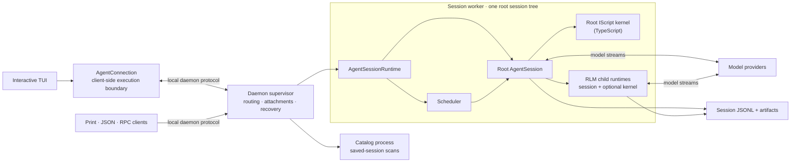
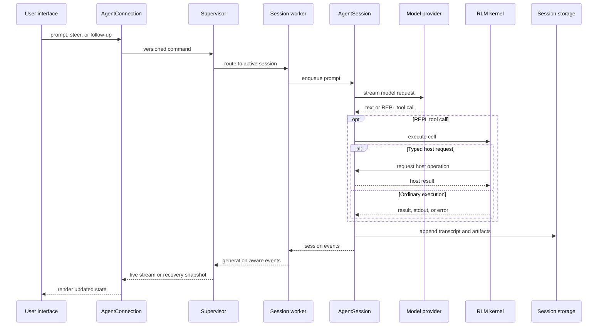

# Architecture Overview

Apollo CLI separates terminal presentation, process coordination, agent execution, the model-facing IScript (TypeScript) REPL, and persisted state (see [IScript Kernel](iscript-kernel.md)). Normal interactive sessions use the daemon-backed path below; explicit SDK and fallback integrations can run the same `AgentSessionRuntime` in process.

## System at a Glance

- The client owns rendering, keyboard input, and local UI preferences; it does not own execution.
- The supervisor owns discovery, routing, attachments, worker health, and cross-agent message delivery.
- Each worker owns one root runtime, its scheduler, kernels, and all descendants below that root.
- `AgentSession` owns provider calls, queues, tools, compaction, goals, child lifecycles, and transcript writes.
- The REPL is the model-facing control environment: IScript (TypeScript) in both source checkouts and installed releases. Typed host requests return authoritative operations to the TypeScript session.

Workers and kernels are separate processes for lifecycle and failure containment, not security sandboxes. They normally run with the same operating-system permissions as the client.

## Prompt Execution Flow

From the session queue onward, the same execution and persistence path is used when a prompt comes from a heartbeat, cron schedule, goal continuation, autonomous mode, or another agent instead of an attached user.

## Apollo CLI Fork Notes

This repository is a fork of PrimeIntellect-ai/prime-agent, renamed Apollo CLI. One change affects the diagrams above:

- The "Python kernel" node in the upstream diagram is now the **IScript (TypeScript) kernel**. Both source checkouts and installed releases resolve to the TypeScript IScript runtime (`apollo-cli-runtime/`, Node `--experimental-strip-types` or Deno). The model-facing tool is `iscript` with `ipython` as an alias of the same implementation. See [IScript Kernel](iscript-kernel.md) for the protocol, snapshots, and remaining integration gaps.

## Detailed Architecture

- [Agent Connection Architecture](agent-connection.md) explains the client/runtime boundary, snapshots, replay, and reconnect behavior.
- [Daemon Architecture](daemon.md) covers process ownership, leases, scheduling, backpressure, and crash recovery.
- [RLM Runtime Architecture](rlm-runtime.md) follows kernel host requests and recursive child execution.
- [Long-Running and Background Agents](long-running-agents.md) shows how detached sessions, messages, goals, and scheduled work share the worker runtime.
